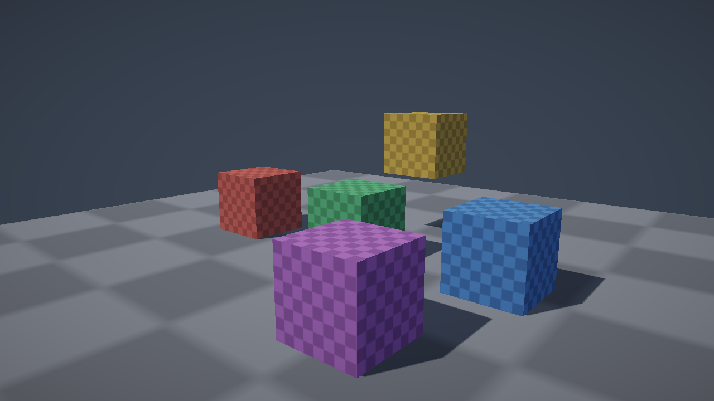

# d3d

**A complete, modular 3D extension for the [Defold](https://defold.com) game engine.**

d3d packages the rendering pipeline, PBR materials, lighting, shadows, cameras
and gameplay-ready prefabs that a 3D game needs, so a project can start at
"beautiful 3D scene" instead of "empty render script".

> Status: **M1 vertical slice**. HDR PBR shading, cascaded directional shadows
> and ACES tone mapping are implemented and compile with Defold 1.14.0. The
> example has been verified on desktop Linux under software OpenGL; HTML5 and
> mobile are next.



## What works today

- HDR forward renderer (`RGBA16F` scene target, linear lighting).
- Metallic-roughness PBR: GGX distribution, Smith visibility, Schlick Fresnel.
- Derivative-based normal mapping, opt-in through the PBR material constant.
- Defold `LightBuffer` integration: ambient, directional, point and spot lights.
- Three-cascade directional shadow maps with PCF, normal-offset bias and
  texel-snapped cascade fitting.
- Distance fog.
- ACES tone mapping + gamma in a fullscreen post pass.
- A self-contained example: orbit camera, moving sun, coloured cubes and
  checker-textured PBR material.

## Quick start

Requirements: **Defold 1.14+** (modern shader pipeline) and Python 3 only if you
want to regenerate the binary assets.

```bash
# Build headlessly (downloads a pinned JDK 25 + bob.jar into .tools/)
./scripts/build.sh

# Or open game.project in the Defold editor and press Build & Run.
```

The example auto-orbits the camera and slowly rotates the sun so the cascades
and shadow filtering are visible immediately.

## Repository layout

```
d3d/                 the library: render script, shaders, materials, modules
example/             the Defold project used to develop and demo the library
docs/                architecture, research notes, offline Defold documentation
docs/defold/         official Defold docs mirror (see its README)
scripts/             docs sync and headless build
tools/               reproducible asset / collection generators
game.project         the example project (or add d3d/ as a library dependency)
```

### Pipeline at a glance

```
shadow cascades (3 × depth) → HDR scene (RGBA16F + depth)
    → ACES tonemap + gamma → GUI
```

The render script reads the built-in camera component and light components; no
parallel camera or light system is introduced. See `docs/ARCHITECTURE.md`.

## Documentation

- `docs/ARCHITECTURE.md` — frame graph, module layout, conventions, milestones.
- `docs/RESEARCH.md` — what d3d takes from Scene3D and Illumination, and why.
- `docs/IMPLEMENTATION.md` — what the M1 slice does and what is still missing.
- `docs/defold/` — 444 official Defold manual/API/example pages, offline.

## Why

Defold ships excellent low-level 3D building blocks — model and mesh components,
a camera component, light components with a `LightBuffer`, glTF/PBR material
data, render targets and compute shaders — but it intentionally leaves the
render pipeline and the higher-level 3D workflow to the developer.

Two community projects show the two halves of the problem:

| Project | Strength | Gap |
| --- | --- | --- |
| [Scene3D](https://github.com/indiesoftby/defold-scene3d) | Cameras, controls, character/car controllers, prefabs, shadow experiments | Lighting is basic; materials are stylised, not PBR |
| [Illumination](https://github.com/astrochili/defold-illumination) | Ready-to-use forward lighting with many point/spot lights, normal/specular maps, fog | No render script, no shadows, no PBR, no post-processing |

d3d combines those strengths on top of the *current* Defold feature set, rather
than reimplementing what the engine now provides.

## Goals

- **Modern pipeline** — HDR forward rendering, PBR metallic-roughness,
  image-based lighting, shadow atlas, tone mapping and a small post FX stack.
- **Scalable lighting** — use Defold's light components, with clustered
  light culling when a scene needs more lights than a naive forward loop can
  afford.
- **Batteries included** — camera rigs, first-person/orbit/follow controllers,
  skybox, fog, debug views and photo mode.
- **Editor-first** — everything usable from the Defold editor with prefabs and
  sensible defaults; no custom build step for the common case.
- **Portable** — desktop, mobile and HTML5. No platform-specific code in the
  core path.
- **Documented** — a complete manual, API reference and runnable examples.

## References

The two reference projects are kept locally for study and are **not** part of
the build or of this repository's history:

- `defold-scene3d-main/` — MIT, Indiesoft LLC
- `defold-illumination-master/` — MIT, Roman Silin

They are listed in `.gitignore`. See `docs/RESEARCH.md` for the analysis.

## License

TBD.
